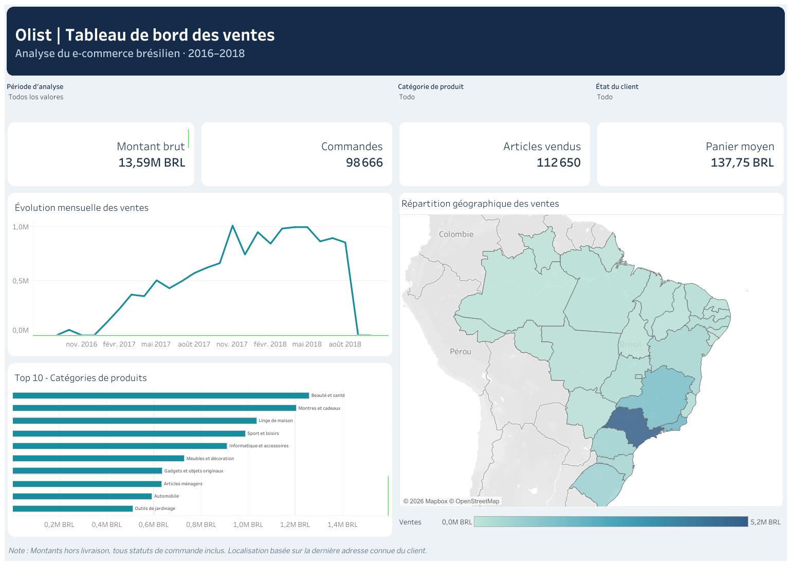

# Olist Data Platform — Pipeline ELT et tableau de bord e-commerce

**Projet de portfolio Data Engineering & Business Intelligence** construit à partir du *Brazilian E-Commerce Public Dataset by Olist*.

Ce projet met en œuvre une chaîne analytique de bout en bout : ingestion de neuf fichiers CSV dans PostgreSQL (Supabase), transformations et tests avec dbt, modélisation dimensionnelle, puis visualisation interactive dans Tableau Public.

[👉 Cliquez ici pour découvrir le tableau de bord interactif](https://public.tableau.com/views/olist_dashboard_17935297605090/Olist-Tableaudeborddesventes?:language=es-ES&publish=yes&:sid=CA04E9DE81E24CC8BBF1D45F1132CF31-0:0&:redirect=auth&:display_count=n&:origin=viz_share_link)

## Objectif et problématique métier

Les données d'une marketplace sont réparties entre commandes, articles, clients, produits, vendeurs, paiements, avis et informations géographiques. Le projet vise à **centraliser et fiabiliser ces données**, puis à faciliter l'analyse des performances commerciales.

Le tableau de bord répond notamment aux questions suivantes :

- Comment évolue le montant brut des articles au fil du temps ?
- Quelles catégories de produits contribuent le plus aux ventes ?
- Comment se répartissent les ventes selon l'État associé au client ?
- Comment varient les commandes, les articles et le panier moyen selon les filtres sélectionnés ?

## Architecture réalisée

```text
Brazilian E-Commerce Public Dataset by Olist (9 CSV)
                        |
                        v
              Python + psycopg / COPY
                        |
                        v
             PostgreSQL / Supabase
                   schema raw
                  (9 tables)
                        |
                        v
                  dbt Core
        +-------------------------------+
        |                               |
        v                               v
 dbt_dev_staging                dbt_dev_reference
    (9 vues)                (seed de 73 catégories FR)
        |                               |
        +---------------+---------------+
                        |
                        v
                  dbt_dev_marts
             (4 dimensions + 1 fait)
                        |
                        v
            Export Python vers CSV
                        |
                        v
          Tableau Public (extrait)
          Dashboard interactif FR
```

Les noms de schémas ci-dessus correspondent à **l'environnement de développement**. Les tables préexistantes du schéma `public` ne sont pas remplacées par les modèles dbt.

## Technologies

| Technologie | Rôle |
|---|---|
| Python | Ingestion, export analytique et scripts utilitaires |
| psycopg / PostgreSQL COPY | Chargement des fichiers CSV dans PostgreSQL |
| Supabase / PostgreSQL | Stockage des sources et des tables analytiques |
| dbt Core + adaptateur PostgreSQL | Transformations SQL, dépendances, seeds et tests |
| SQL | Modélisation dimensionnelle et contrôles de cohérence |
| Tableau Public | Visualisations, filtres et tableau de bord |
| Git / GitHub | Versionnement et revue des modifications |

## Sources et préparation des données

Les **9 fichiers sources Olist** sont ingérés dans le schéma `raw`, sans écraser les données originales. Les **9 modèles de staging** standardisent les colonnes et préparent les sources pour les analyses.

Un **seed dbt de 73 catégories en français** complète les traductions des noms de produits. Les traductions anglaises absentes ne sont pas inventées.

## Modèle dimensionnel

La couche `dbt_dev_marts` contient les modèles suivants :

| Modèle | Granularité | Volume validé |
|---|---|---:|
| `fact_sales` | Un article par commande (`order_id`, `order_item_id`) | 112 650 |
| `dim_product` | Un produit | 32 951 |
| `dim_seller` | Un vendeur | 3 095 |
| `dim_customer` | Un client réel (`customer_unique_id`) | 96 096 |
| `dim_date` | Une date calendaire | Selon la période couverte |

La table `fact_sales` référence les dimensions via `product_id`, `seller_id`, `customer_key` et `date_id`.

### Définitions des KPI

| KPI | Définition |
|---|---|
| Montant brut des articles | `SUM(price)` |
| Nombre de commandes | `COUNT(DISTINCT order_id)` |
| Articles vendus | Nombre de lignes d'articles de commande |
| Panier moyen | `SUM(price) / COUNT(DISTINCT order_id)` |

**Précautions d'interprétation :** les montants correspondent aux prix des articles **hors frais de livraison** et incluent **tous les statuts de commande**. Ils ne doivent pas être assimilés au chiffre d'affaires net ou aux seules commandes livrées. La localisation du client reflète sa **dernière localisation observée** dans les données, et non nécessairement l'adresse de livraison de chaque commande.

## Qualité des données et validation

Le projet comprend des tests dbt sur les clés, les valeurs obligatoires, les relations et le grain de la table de faits. Des tests SQL de réconciliation vérifient également :

- l'absence d'articles manquants ou supplémentaires entre `raw.olist_order_items` et `fact_sales` ;
- la concordance du prix de chaque article ;
- la concordance du montant total ;
- la cohérence des agrégations mensuelles et des indicateurs du dashboard.

L'exécution intégrale de `dbt build` et les contrôles SQL ont été validés au cours du projet.

## Tableau de bord interactif

Le dashboard propose :

- quatre KPI : montant brut, commandes, articles et panier moyen ;
- une évolution mensuelle des ventes ;
- un Top 10 des catégories de produits en français ;
- une carte des ventes par État du client au Brésil ;
- des filtres par période, catégorie et État ;
- des interactions par sélection des barres et des régions de la carte, ainsi que des info-bulles détaillées.

Le classeur est conservé dans `tableau/olist_dashboard.twbx`. Les données utilisées par Tableau Public sont issues d'un **export**, et non d'une connexion PostgreSQL en temps réel.



## Reproduire la couche de transformation et l'export

Les commandes suivantes sont prévues pour **Windows / PowerShell**, depuis la racine du dépôt. Elles supposent que les dépendances du projet sont installées et que le fichier local `.env` contient une `DATABASE_URL` PostgreSQL valide.

```powershell
# Activer l'environnement virtuel existant
.\.venv\Scripts\Activate.ps1

# Exécuter les modèles, seeds et tests dbt
python .\src\setup_dbt_env.py build

# Exporter les cinq tables analytiques pour Tableau
python .\src\export_tableau_data.py
```

L'export crée les CSV dans `data/tableau/`. Ces fichiers sont ignorés par Git. Les identifiants de connexion doivent rester dans des fichiers locaux ou variables d'environnement, **jamais dans le dépôt**.

La reproduction complète depuis les CSV sources nécessite également le paramétrage de l'environnement Supabase et l'exécution des scripts d'ingestion du dépôt.

## Structure du dépôt

```text
olist-data-platform/
├── dbt/olist_analytics/        # Sources, staging, marts, seeds, tests
├── src/                       # Ingestion, configuration dbt, export Tableau
├── doc/                      # Documentation technique et métier
├── tableau/
│   └── olist_dashboard.twbx
├── sql/                       # Scripts SQL du projet
├── README.md
└── .gitignore
```

Documentation complémentaire :

- [`doc/dbt_architecture.md`](doc/dbt_architecture.md) — architecture dbt et décisions de modélisation ;
- [`doc/business_metrics.md`](doc/business_metrics.md) — définitions et limites des indicateurs.

## Limites et évolutions possibles

- Le dataset est historique et le tableau de bord publié n'est pas alimenté en temps réel.
- La clé `customer_key`, calculée lors de la construction du modèle, devra être stabilisée pour un pipeline incrémental.
- Une publication des modèles dans un schéma analytique dédié et un système d'actualisation automatisé restent des évolutions possibles.
- L'analyse approfondie des délais de livraison, des avis clients et de la performance logistique, envisagée lors du cadrage initial, n'est pas intégrée au dashboard actuel.
- L'automatisation complète via GitHub Actions était un objectif initial ; elle n'est pas présentée ici comme une fonctionnalité livrée.

## Données

Source : *Brazilian E-Commerce Public Dataset by Olist*. Ce dépôt présente une implémentation pédagogique et analytique indépendante, réalisée à des fins de portfolio.
